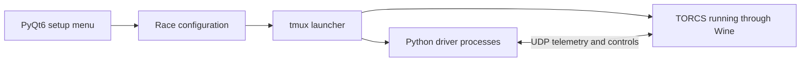

# TORCS Multiplayer Racing Controllers

A team project at Trinity College Dublin for running autonomous Python drivers against each other in **TORCS**. The objective is to compare driving behaviours in a shared race, with a graphical setup screen and a repeatable container-based launch process.

## My role and contributions

I worked on the Python controllers and early multiplayer integration. I added a second-car controller, expanded the prototype to six driver configurations, and varied speed, steering, braking and traction-control settings to produce different driving behaviours. I also organised controller filenames for shell-loop launching and added race-end process cleanup to the earlier `gym_torcs` harness.

These contributions are recorded in commits [4d6bcc9](https://github.com/Npola1/torcs-car/commit/4d6bcc9), [6a44a46](https://github.com/Npola1/torcs-car/commit/6a44a46), [03e29ee](https://github.com/Npola1/torcs-car/commit/03e29ee), [a424dbd](https://github.com/Npola1/torcs-car/commit/a424dbd) and [f01247b](https://github.com/Npola1/torcs-car/commit/f01247b). The current graphical launcher and container reflect the wider team's subsequent integration work.

## System architecture



- [Torcs.sh](Torcs.sh) builds the Podman image when its inputs change and forwards the host's graphics/audio connections.
- [menu_multiplayer.py](launch_menu/menu_multiplayer.py) selects one to eight players and a controller script for each.
- [containerrun.py](containerrun.py) updates the race's `scr_server` entries; [launch.sh](launch.sh) starts each controller on its own UDP port, beginning at **3001**.
- [Scripts/](Scripts/) contains the current driver choices. [gym_torcs/](gym_torcs/) retains the earlier harness and controller prototypes.

The [container](podman/Containerfile) supplies Python 3.13, the Python dependencies, Wine, tmux and graphics libraries. Controller logic uses simulator telemetry to choose steering, throttle, braking and gears.

## How to run

Use an x86 Linux desktop with Wayland, or WSL2 with WSLg, plus Podman, Git and GNU `sha256sum`. The display sockets must be available for GUI forwarding. The current container defaults Qt to Wayland; X11-only setups need the Qt platform changed to `xcb` and the corresponding display forwarding. A native macOS/ARM launch is not established.

```bash
git clone https://github.com/Npola1/torcs-car.git
cd torcs-car
chmod +x Torcs.sh
./Torcs.sh
```

1. Allow the initial container build to complete; the Python dependencies install inside it.
2. Choose the player count in the setup window.
3. Browse to `/torcs/Scripts` **inside the container** and choose one script per player.
4. Click **Launch TORCS**, then proceed through the simulator's default race selections to start.

To add a controller, put it in the repository's `Scripts/` folder **before** launching; the wrapper rebuilds the image. Controllers must accept the `-p` port argument. The picker does not copy arbitrary host files into the container.

## Attribution and verification

This is collaborative coursework built on TORCS, `gym_torcs` and IBM-provided controller code, including adaptations credited in the original project to Bath Spa, Essex, Exeter and UCL. Original authorship remains in the Git history. The project originated on TCD's private GitLab; this GitHub copy also preserves imported history.

The README's paths, player limits and port allocation were checked against the source, and the launcher/controller syntax checks passed. A graphical race was not executed during this documentation update.
